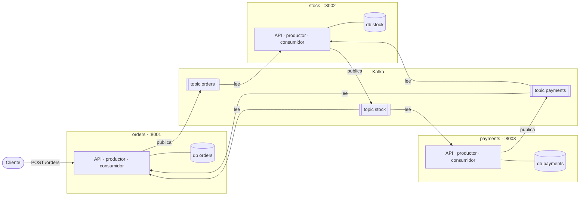
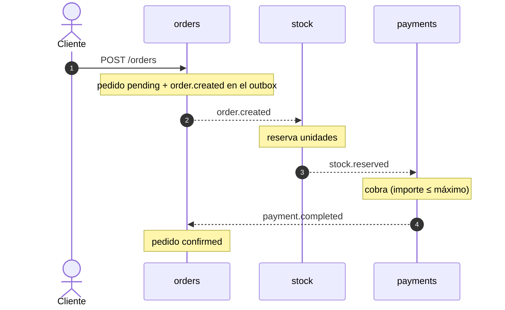
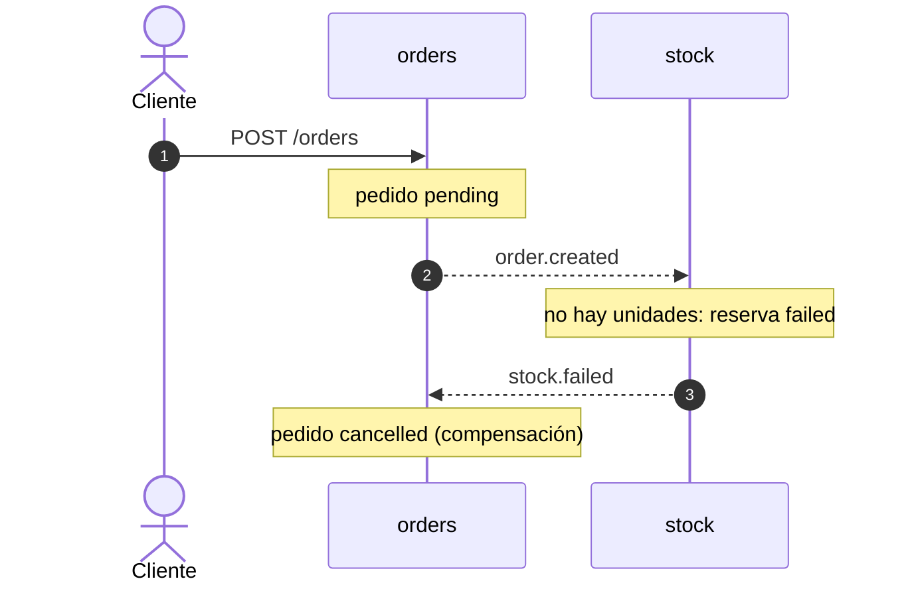
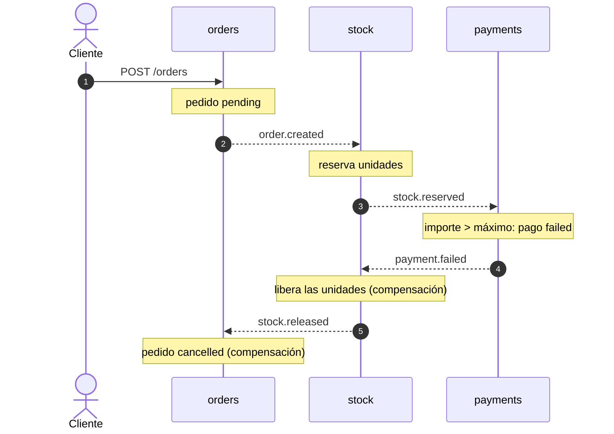

# OrderSaga

Saga por coreografía entre tres microservicios con FastAPI y Kafka. Ningún servicio llama a otro: cada uno guarda
su cambio, publica un evento en su topic y los demás reaccionan. Si un paso falla, los anteriores se compensan.

Proyecto de aprendizaje: el objetivo es entender el patrón saga, no construir una tienda.

## Arquitectura



- Cada servicio tiene su propia base de datos PostgreSQL y nadie más la toca.
- Cada servicio publica solo en su propio topic. Los topics tienen 3 particiones y usan el `order_id` como clave.
- Cada servicio son tres procesos con la misma imagen: la API, el productor del outbox y el consumidor.
  Nueve procesos en total.

| Servicio | Paso | Compensación |
|---|---|---|
| orders | Crea el pedido (`pending`) | Lo cancela (`cancelled`) |
| stock | Reserva las unidades | Las libera |
| payments | Cobra | — (es el último paso: nada después puede obligarle a deshacer) |

## Los tres caminos

### Camino feliz



### Sin stock



### Pago rechazado

Falla el último paso: los anteriores se deshacen en orden inverso, primero la reserva y después el pedido.



## Eventos

Seis eventos en tres topics. Todos llevan los mismos campos: `event_type`, `order_id`, `product_id`, `quantity`
y `amount`, así ningún servicio tiene que preguntarle nada a otro.

| Topic | Evento | Significa | Lo lee |
|---|---|---|---|
| orders | `order.created` | Hay un pedido nuevo en `pending` | stock |
| stock | `stock.reserved` | Las unidades del pedido están apartadas | payments |
| stock | `stock.failed` | No había unidades y no se reservó nada | orders |
| stock | `stock.released` | Se devolvieron al almacén las unidades reservadas | orders |
| payments | `payment.completed` | El pedido está cobrado | orders |
| payments | `payment.failed` | El cobro se rechazó porque el importe supera el máximo | stock |

No existen `order.confirmed` ni `order.cancelled`: nadie los escucharía. Con el outbox, añadirlos el día que haya
un consumidor es insertar una fila más.

## Decisiones clave

- **Reservar antes de cobrar.** Reservar es barato e invisible para el cliente; devolver dinero no.
- **Cada paso es una transacción.** El cambio del servicio y el evento siguiente se guardan juntos en el outbox;
  el productor los publica después. Nunca hay un cambio sin evento ni un evento sin cambio.
- **Commit del offset después de la transacción.** Si el consumidor muere entre las dos cosas, el evento se
  reprocesa, y la idempotencia lo absorbe.
- **Idempotencia por clave de negocio.** `order_id` es la clave primaria de reservas y pagos, y los cambios de
  estado son UPDATE condicionales. Un evento repetido no reserva, cobra, libera ni cancela dos veces, y tampoco
  genera eventos duplicados hacia el siguiente servicio.
- **Las reservas fallidas no se borran.** La fila en `failed` es la que detecta un `order.created` repetido.
- **La compensación usa los datos propios.** `release_stock` devuelve las unidades que dice la reserva, no las del
  evento.
- **Orders cancela cuando la compensación ha terminado** (`stock.failed` o `stock.released`), nunca con
  `payment.failed`: así un pedido `cancelled` significa que no queda nada retenido.

## Cómo ejecutarlo

Requisitos: Docker, uv y `jq`.

```bash
make up                  # construye y levanta todo, y espera a que esté sano
make logs                # sigue los logs de los nueve procesos
make down                # para y borra contenedores y datos
make check               # ruff y mypy en cada servicio
make test                # tests de cada servicio contra un PostgreSQL real (ver Tests)
```

Cada bloque del desarrollo tiene un script que arranca el sistema desde cero, imprime OK o FALLO por comprobación
y lo apaga al terminar:

```bash
bash scripts/bloque1.sh  # orders y el outbox
bash scripts/bloque2.sh  # camino feliz completo
bash scripts/bloque3.sh  # sin stock y pago rechazado, con sus compensaciones
```

Para probarlo a mano tras `make up` (catálogo inicial: 5 teclados y 1 monitor; importe máximo: 1000):

```bash
curl -s -X POST localhost:8001/orders -H 'Content-Type: application/json' \
  -d '{"product_id": "teclado", "quantity": 2, "amount": 50}'
curl -s localhost:8001/orders/<id>       # pending → confirmed
curl -s localhost:8002/stock/teclado     # unidades disponibles
curl -s localhost:8003/payments/<id>     # estado del pago
```

## Tests

Hay dos niveles de pruebas, y cada uno cubre lo que el otro no:

| | Qué prueba | Cómo |
|---|---|---|
| `make test` | Las reglas de cada servicio por separado: `service.py`, `events_handlers.py` y `routes.py` | pytest contra un PostgreSQL real, sin Kafka |
| `scripts/bloque*.sh` | La saga de punta a punta: productores, consumidores y Kafka | El sistema completo levantado con Docker Compose |

`make test` recorre los tres servicios y para en el primero que falle. Para uno solo:
`cd services/stock && uv run pytest`.
No hace falta `make up`: solo necesita Docker, porque cada servicio arranca su propio contenedor.

**Montaje** (`tests/conftest.py`, igual en los tres servicios):

- Un contenedor `postgres:18` con [testcontainers](https://testcontainers.com/) por sesión de pytest. Arranca antes
  de importar `app`, porque `app/db.py` crea el engine al importarse y tiene que apuntar ya a ese contenedor.
- Las tablas se crean una vez por sesión y se vacían antes de cada test (`TRUNCATE ... RESTART IDENTITY CASCADE`);
  en stock se carga además el catálogo inicial. Cada test empieza limpio y no depende del orden.
- Un único event loop para toda la sesión: el engine y sus conexiones asyncpg quedan ligados al loop donde se
  crean.
- Las rutas se prueban con `httpx.AsyncClient` sobre la app en memoria, sin lifespan: las tablas las ponen las
  fixtures.
- Nada de mocks: las reglas que importan (`ON CONFLICT`, UPDATE condicionales, `RETURNING`) solo se pueden probar
  contra PostgreSQL de verdad.

**Qué se comprueba:**

| Servicio | Tests | Reglas |
|---|---|---|
| orders | 20 | Crear deja el pedido en `pending` con su `order.created` en el outbox; confirmar y cancelar solo actúan sobre `pending`, son idempotentes y no escriben eventos; los handlers confirman con `payment.completed`, cancelan con `stock.failed` o `stock.released` e ignoran el resto; las rutas validan la entrada (422) y devuelven 404 si no existe |
| stock | 23 | Reservar descuenta y publica `stock.reserved`; sin unidades o con un producto inexistente, la reserva queda en `failed` y se publica `stock.failed`; liberar devuelve las unidades de la reserva (no las del evento) y publica `stock.released`; reservar y liberar repetidos solo actúan una vez; liberar una reserva `failed` o inexistente no hace nada |
| payments | 12 | Hasta el importe máximo (incluido) el pago queda `completed`; por encima, `failed`, cada uno con su evento; un `stock.reserved` repetido cobra una sola vez; solo `stock.reserved` cobra |

Los tests de "no hace nada" preparan primero un estado que la función equivocada sí cambiaría (por ejemplo, una
reserva antes de un `payment.completed`). Así fallan si un handler manda el evento a otra función.

## Estructura

```
ordersaga/
  compose.yml  Makefile  ordersaga.code-workspace
  scripts/                 un script de comprobación por bloque
  services/
    orders/  stock/  payments/
      app/
        main.py              API y lifespan (create_all)
        config.py  db.py     configuración y conexión
        models.py            tablas del servicio, incluida la outbox
        schemas.py           API y el evento de la saga
        service.py           reglas de negocio: el cambio y su evento, en una transacción
        routes.py            puerta HTTP
        events_handlers.py   puerta de eventos: qué evento va a qué función
        events_producer.py   publica el outbox en Kafka
        events_consumer.py   lee los topics y confirma cada offset tras procesarlo
      tests/
        conftest.py          PostgreSQL en un contenedor, tablas limpias por test, sesión y cliente HTTP
        test_service.py      reglas de negocio
        test_handlers.py     qué evento va a qué función
        test_routes.py       respuestas HTTP
```

Stack: Python 3.14, uv, FastAPI, SQLAlchemy 2 async + asyncpg, PostgreSQL 18, Kafka 4 (KRaft) con aiokafka,
Docker Compose. Tests con pytest, pytest-asyncio, httpx y testcontainers.

## Límites conocidos

Fuera del alcance del proyecto, a propósito:

- **Mensajes imposibles de procesar.** Un mensaje mal formado tumba el consumidor y, al reiniciarse, lo vuelve a
  leer: la partición queda bloqueada. Lo habitual es apartarlo a un topic de cartas muertas (DLQ) y seguir.
- **Una compensación que falla.** Si la liberación de stock no puede completarse, el pedido se queda en `pending`.
  Lo habitual es reintentar con espera creciente y, si sigue fallando, marcarlo para revisión manual.
- **Sin migraciones ni autenticación.** Las tablas se crean al arrancar con `create_all`.
